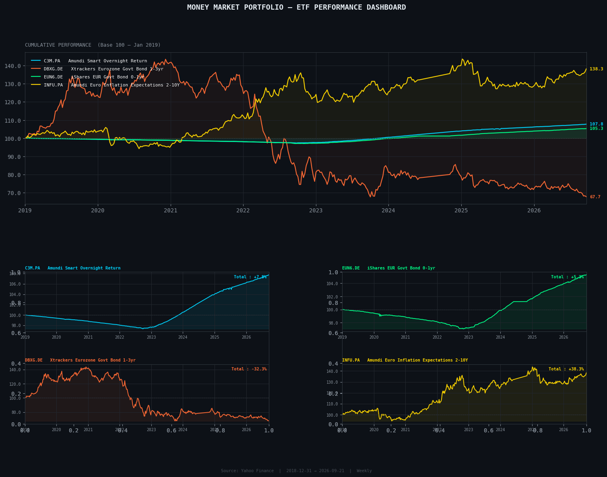
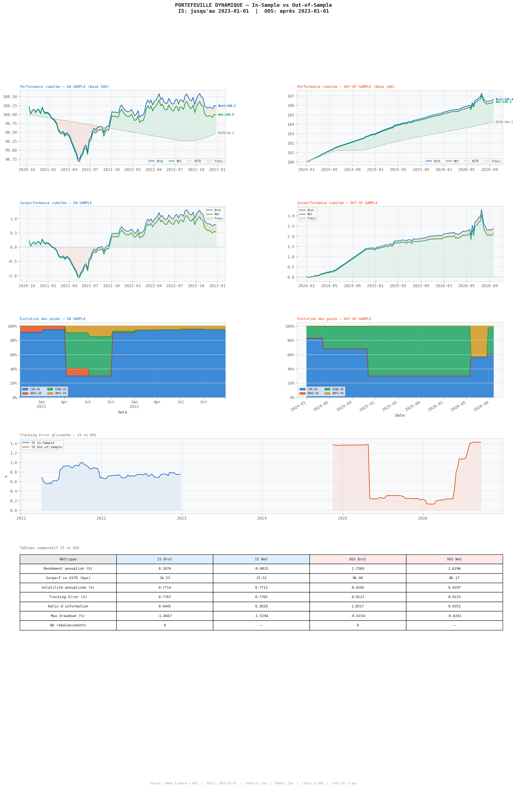
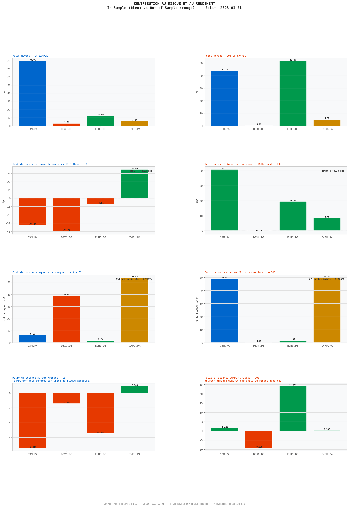

# Gestion d'un Portefeuille d'ETF Monétaires et de Taux

> Stratégie quantitative de gestion de trésorerie construite sur la minimisation de la tracking error, benchmarkée contre le taux €STR de la BCE. Le modèle est validé sur données réelles par un backtest walk-forward avec séparation stricte entre période d'apprentissage et période de test.

[](https://www.python.org/)
[](https://github.com/dayankoffi)
[](https://www.ecb.europa.eu)
[](https://github.com/dayankoffi)
[](https://github.com/dayankoffi)

---

## Contexte et motivation

La gestion de trésorerie se réduit trop souvent à une exposition passive aux taux au jour le jour. Ce projet explore une approche différente : à partir d'un univers restreint de quatre ETF liquides en euros, couvrant des segments distincts de la courbe obligataire courte, la stratégie construit un portefeuille dynamique qui cherche systématiquement à surperformer l'€STR tout en maintenant une tracking error maîtrisée.

Le benchmark choisi est l'€STR lui-même, téléchargé quotidiennement depuis le portail de données de la BCE et capitalisé semaine par semaine, plutôt qu'un ETF de réplication. Ce choix est délibéré : utiliser C3M comme benchmark aurait compressé artificiellement la tracking error mesurée et masqué le vrai coût des frais de gestion.

Le portefeuille est rééquilibré chaque trimestre. À chaque date de rebalancement, l'optimiseur ne dispose que des données passées, sans aucune information future. C'est cette discipline walk-forward qui rend le backtest crédible et directement comparable à une gestion réelle.

---

## Univers d'investissement

Quatre ETF ont été sélectionnés pour couvrir quatre sources de rendement distinctes dans l'espace obligataire court terme en euros.

| ETF | Ticker | ISIN | Catégorie | TER |
|---|---|---|---|---|
| Amundi Smart Overnight Return | C3M.PA | LU1190417599 | Overnight €STR | 0,10% |
| Xtrackers Eurozone Govt Bond 1-3yr | DBXG.DE | LU0468896575 | Souverain court | 0,15% |
| iShares EUR Govt Bond 0-1yr | EUN6.DE | IE00BGSF1X88 | Souverain ultra-court | 0,10% |
| Amundi Euro Inflation Expectations 2-10Y | INFU.PA | LU1650491282 | Points morts d'inflation | 0,25% |

Chaque ETF apporte un facteur de risque différent au portefeuille : sensibilité au taux overnight, risque de taux court souverain, et anticipations d'inflation. Cette diversité est ce qui rend l'optimisation pertinente.

---

## Graphique 1 — Performance cumulée de l'univers (Base 100)



Le graphique principal présente la performance cumulée des quatre ETF depuis janvier 2019, indexée à 100 à la date de départ. Plusieurs observations ressortent immédiatement.

INFU affiche la performance totale la plus élevée sur la période complète avec +38,3%, portée par la forte remontée des anticipations d'inflation en zone euro entre 2021 et 2023. Cette progression n'est cependant pas linéaire : l'ETF subit une correction marquée en 2020 avant de rebondir, puis connaît une phase de volatilité élevée lors du cycle de resserrement monétaire.

DBXG est l'instrument qui illustre le mieux le risque de duration sur la période. Sa progression jusqu'en 2021 reflète l'environnement de taux bas et de recherche de rendement, puis sa chute à 67,7 en 2026 matérialise l'impact de la hausse des taux directeurs de la BCE sur les obligations souveraines 1-3 ans. Cette perte de 32,3% sur la période complète rappelle que même un ETF à maturité courte peut subir des pertes significatives en phase de resserrement rapide.

C3M et EUN6 présentent des profils opposés : stables et légèrement croissants tout au long de la période, avec des performances totales de +7,0% et +5,9% respectivement. C3M réplique l'€STR et constitue le cœur liquide du portefeuille ; EUN6 ajoute un léger surplus de rendement via les obligations souveraines très courtes.

Les quatre sous-graphiques individuels confirment ces tendances et montrent que C3M et EUN6 n'ont jamais repassé sous leur valeur initiale, ce qui valide leur rôle de socle défensif dans la construction de portefeuille.

---

## Méthodologie

### Construction du benchmark

Le benchmark est le taux €STR publié quotidiennement par la BCE. Il est converti en rendements hebdomadaires selon la convention Exact/360 propre aux marchés monétaires en euros, puis capitalisé à partir de la première date disponible en octobre 2019. Cette approche évite le biais de frais et l'erreur de réplication qu'introduirait l'utilisation de C3M comme proxy.

### Rendements nets de frais

Avant toute optimisation, les TER sont déduits des rendements hebdomadaires bruts à la maille de chaque ETF. L'optimiseur travaille donc sur le rendement net réellement perçu par l'investisseur, et toutes les métriques de performance reflètent ce que la stratégie délivre effectivement.

### Modèle d'optimisation

Le problème central est une **minimisation de la tracking error sous contrainte de surperformance minimale**, résolu par programmation quadratique convexe via CVXPY avec le solveur CLARABEL.

À chaque date de rebalancement, l'optimiseur estime la matrice de covariance active et les rendements actifs espérés sur les 52 semaines précédentes uniquement, puis résout le programme suivant :

```
Minimiser    w' Σ_active w

Sous contrainte :
    Σ w_i = 1                     (portefeuille pleinement investi)
    w_i ≥ 0                       (pas de vente à découvert)
    w_C3M ≥ 30%                   (plancher de liquidité)
    μ_active' w ≥ cible           (surperformance minimale, défaut 50 bps/an)
```

Le résultat est l'allocation qui atteint la cible de surperformance avec la tracking error la plus basse possible, soit le point de ratio d'information maximal sur la frontière efficiente pour une cible donnée.

### Validation walk-forward

Le backtest démarre à la première date pour laquelle 52 semaines d'historique sont disponibles. Toutes les 13 semaines, l'optimiseur ré-estime ses paramètres sur la fenêtre glissante et applique les nouveaux poids à la période suivante. Des coûts de transaction de 2 points de base par unité de rotation du portefeuille sont déduits à chaque rebalancement.

La base de données est découpée en deux périodes non chevauchantes :

- **In-Sample (IS)** : calibration du modèle et validation initiale, jusqu'en janvier 2023
- **Out-of-Sample (OOS)** : période strictement non vue pendant le développement, de janvier 2023 à septembre 2026

Si l'optimiseur ne trouve pas de solution faisable à une date donnée, l'allocation précédente est maintenue sans modification.

---

## Graphique 2 — Dashboard IS vs OOS



Ce dashboard est le cœur de la validation du modèle. Il présente côte à côte les résultats de la période In-Sample (colonne gauche, en bleu) et Out-of-Sample (colonne droite, en rouge), avec le même dispositif de lecture pour les deux.

**Performance cumulée.** En IS, le portefeuille évolue dans un couloir étroit autour de l'€STR, avec des épisodes de sous-performance en 2021 liés à la phase de taux négatifs profonds où le modèle peinait à trouver des sources de rendement supérieures au benchmark. En OOS, la situation s'inverse nettement : le portefeuille brut atteint 106,4 contre 104,2 pour l'€STR, soit une surperformance cumulée de plus de 2 points en environ trois ans. La zone verte persistante entre la courbe du portefeuille et celle du benchmark traduit une alpha stable et non concentrée sur quelques semaines.

**Évolution des poids.** Le contraste entre IS et OOS est frappant. En IS, C3M domine à près de 80%, l'optimiseur jugeant que les autres instruments n'offrent pas suffisamment de rendement actif pour justifier le risque de tracking error supplémentaire dans un environnement de taux négatifs. En OOS, EUN6 prend le relais et capte plus de 50% de l'allocation : la normalisation des taux courts en zone euro a rendu les obligations souveraines 0-1 an nettement plus attractives en termes de rendement ajusté au risque.

**Tracking error glissante.** La tracking error IS oscille entre 0,4% et 0,9% sur 52 semaines glissantes, ce qui correspond à un niveau cohérent avec un mandat de trésorerie prudent. En OOS, elle connaît une phase de compression à partir de 2025 avant de remonter légèrement en 2026, signe que le modèle s'adapte aux conditions de marché sans dérapage majeur.

**Tableau comparatif.** Le ratio d'information passe de 0,30 net en IS à 0,94 net en OOS. Un ratio qui s'améliore hors échantillon est le signal le plus fort qu'un modèle quantitatif puisse donner : il indique que la structure captée pendant la calibration correspond à quelque chose de réel et de persistant dans les données, et non à du bruit statistique.

---

## Résultats quantitatifs

### Métriques clés IS et OOS

| Métrique | IS Brut | IS Net | OOS Brut | OOS Net |
|---|---|---|---|---|
| Rendement annualisé (%) | 0,1076 | -0,0025 | 2,7369 | 2,6296 |
| Surperformance vs €STR (bps) | 34,53 | 23,52 | 96,90 | 86,17 |
| Volatilité annualisée (%) | 0,7714 | 0,7713 | 0,9295 | 0,9297 |
| Tracking Error (%) | 0,7767 | 0,7765 | 0,9213 | 0,9215 |
| Ratio d'information | 0,4445 | 0,3028 | 1,0517 | 0,9351 |
| Max Drawdown (%) | -1,4667 | -1,5294 | -0,8154 | -0,8281 |
| Nombre de rebalancements | 9 | 9 | 8 | 8 |

La surperformance nette de 86 bps en OOS, pour une tracking error inférieure à 1%, représente un résultat solide dans un univers aussi restreint. Le max drawdown contenu à -0,83% en OOS confirme le caractère défensif de la stratégie, cohérent avec un mandat de trésorerie.

---

## Graphique 3 — Attribution du risque et du rendement IS vs OOS



Ce dashboard décompose la performance et le risque du portefeuille instrument par instrument, séparément pour les deux périodes. Il répond à la question centrale de tout gérant actif : qui génère l'alpha et à quel coût en risque ?

**Poids moyens.** La bascule d'allocation entre IS et OOS est visible immédiatement. En IS, C3M occupe 79,4% du portefeuille, EUN6 12,0% et INFU 5,8%. En OOS, EUN6 monte à 51,4% tandis que C3M redescend à 43,7%. Cette rotation reflète l'adaptation du modèle au nouveau régime de taux : les obligations souveraines très courtes sont devenues attractives une fois que les taux ont repassé en territoire positif.

**Contribution à la surperformance.** En IS, seul INFU contribue positivement (+34,66 bps) malgré un poids de seulement 5,8%. Les trois autres instruments sont des freins à la surperformance dans cet environnement de taux négatifs. En OOS, tous les instruments sauf DBXG contribuent positivement : C3M apporte 40,72 bps, EUN6 19,43 bps et INFU 8,40 bps, pour un total de 68,29 bps bruts.

**Contribution au risque.** En IS, INFU consomme 53,6% du risque actif total pour seulement 5,8% du portefeuille, ce qui traduit une concentration de risque importante sur cet instrument. En OOS, la répartition devient beaucoup plus équilibrée entre C3M (49,0%) et INFU (49,5%), EUN6 ne représentant que 1,4% du risque malgré 51,4% du poids, signe d'une corrélation très forte avec le benchmark €STR sur cette période.

**Ratio d'efficience.** C'est le graphique le plus parlant. En IS, EUN6 affiche un ratio d'efficience de -5,46 et DBXG de -1,43 : ces deux instruments génèrent de la sous-performance par unité de risque apportée. En OOS, EUN6 se transforme avec un ratio de 23,96, le meilleur de l'univers de loin. Cette révélation est précisément ce que la séparation IS/OOS permet de mettre en lumière : un instrument peut sembler peu attractif sur une période et devenir le moteur principal sur la suivante lorsque le régime de marché change.

---

## Commentaire analytique

La période couverte par ce backtest est particulièrement riche du point de vue des marchés de taux. Elle comprend la phase de taux profondément négatifs jusqu'à mi-2022, le cycle de resserrement le plus rapide jamais exécuté par la BCE entre juillet 2022 et septembre 2023, puis le début d'une normalisation progressive. Ces trois régimes se comportent très différemment pour un portefeuille exposé à la duration, et le dispositif walk-forward force le modèle à s'adapter en temps réel plutôt qu'à bénéficier de la connaissance a posteriori.

INFU est l'instrument le plus singulier de l'univers. Il réplique les points morts d'inflation plutôt que les taux nominaux, ce qui lui confère une sensibilité à l'environnement inflationniste que les autres ETF n'ont pas. Cette propriété de décorrélation est théoriquement précieuse pour un optimiseur, mais elle s'accompagne d'une volatilité active élevée. Son maintien dans l'univers se justifie par sa capacité à générer de l'alpha en période de surprises inflationnistes, mais son poids doit rester contenu pour ne pas déstabiliser la tracking error globale.

Le plancher de 30% sur C3M est un choix de conception et non une contrainte arbitraire. Dans le cadre d'un mandat de trésorerie, la liquidité est une exigence structurelle. Un portefeuille entièrement alloué en duration et en inflation peut surperformer en phase de détente mais ne peut pas légitimement être présenté comme un outil de gestion de trésorerie. Le plancher ancre l'identité de la stratégie quelle que soit la décision de l'optimiseur.

---

## Structure du projet

```
MoneyMarket-ETF-Portfolio/
│
├── README.md
├── MoneyTaux_PM.ipynb              Notebook principal, 11 sections documentées
│
└── results/
    ├── money_market_port.png       Performance cumulée des ETF base 100
    ├── Port_dynamique.png          Dashboard IS vs OOS
    └── Contribution_risque.png     Attribution risque et rendement IS vs OOS
```

---

## Structure du notebook

```
Section 01   Imports et dépendances
Section 02   Définition de l'univers et collecte des données (Yahoo Finance)
Section 03   Contrôle qualité et nettoyage des données
Section 04   Construction du benchmark €STR (BCE Data Portal)
Section 05   Alignement des séries et calcul des rendements nets de frais
Section 06   Analyse exploratoire — graphique de performance base 100
Section 07   Modèle d'optimisation — minimisation de la tracking error
Section 08   Frontière efficiente et portefeuille optimal
Section 09   Backtest dynamique walk-forward avec rebalancement trimestriel
Section 10   Découpage IS vs OOS et validation hors échantillon
Section 11   Attribution du risque et du rendement IS vs OOS
```

---

## Éléments théoriques

**Pourquoi minimiser la tracking error plutôt que maximiser le ratio de Sharpe ?**

Dans un contexte de gestion de trésorerie, l'objectif n'est pas de maximiser le rendement absolu mais de battre un benchmark stable de façon régulière. La minimisation de la tracking error sous contrainte de surperformance est la formulation naturelle de cet objectif. Elle produit des portefeuilles stables, lisibles, et comparables à la façon dont les gérants obligataires professionnels sont réellement évalués.

**Pourquoi utiliser l'€STR directement plutôt qu'un ETF de réplication ?**

L'€STR est un taux, pas un prix. Utiliser C3M comme benchmark reviendrait à mesurer la surperformance par rapport à un instrument qui prélève lui-même des frais et accumule une erreur de réplication. La surperformance mesurée serait surévaluée et la tracking error artificiellement comprimée.

**Pourquoi une fenêtre d'estimation de 52 semaines ?**

La fenêtre doit être suffisamment longue pour produire une estimation stable de la matrice de covariance, mais suffisamment courte pour rester sensible aux changements de régime récents. À fréquence hebdomadaire, 52 observations correspondent à un an d'historique, ce qui constitue un équilibre raisonnable entre stabilité et réactivité.

**Pourquoi 13 semaines entre les rebalancements ?**

Le rééquilibrage trimestriel est la norme en gestion de trésorerie. Il limite les coûts de transaction tout en garantissant que l'allocation ne dérive pas trop longtemps de la recommandation de l'optimiseur.

---

## Installation

```bash
pip install yfinance pandas numpy matplotlib seaborn cvxpy requests
```

Le téléchargement de l'€STR nécessite un accès internet à l'API SDMX de la BCE, sans clé d'authentification requise.

---

## Auteur

**Dayan Koffi**
*Finance Quantitative — Marchés de Taux et Gestion de Trésorerie*

Ce projet constitue le volet taux d'une série consacrée à la gestion de portefeuille systématique. Le volet actions, centré sur l'optimisation Black-Litterman avec vues ESG dynamiques, est disponible dans le dépôt [PORTFOLIO-ETHICS-BLACK-LITTERMAN](https://github.com/dayankoffi/PORTFOLIO-ETHICS-BLACK-LITTERMAN).
